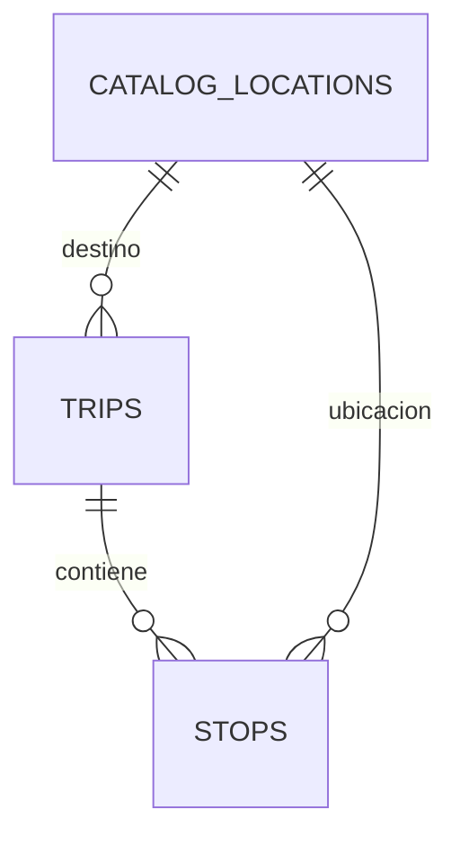

# Modelo relacional SQLite

| Entidad | Clave primaria | Atributos principales | Relaciones |
| --- | --- | --- | --- |
| catalog_locations | key TEXT | name TEXT, lat REAL, lng REAL, icon TEXT, description TEXT opcional | Un lugar puede ser destino o parada en muchos viajes. |
| trips | id TEXT | name TEXT, dest_key TEXT, departure_iso TEXT, created_at y updated_at DATETIME | dest_key referencia catalog_locations.key. |
| stops | id INTEGER | trip_id TEXT, stop_key TEXT, stay_min INTEGER, sequence_order INTEGER | trip_id referencia trips.id. stop_key referencia catalog_locations.key. |

Cada viaje tiene un destino y de cero a diez paradas, según la regla del servicio. Las paradas se ordenan por sequence_order. Borrar un viaje elimina sus paradas en cascada. Una ubicación referenciada se protege mediante claves foráneas y la API devuelve 409 al intentar borrarla. Una escritura de viaje y sus paradas se confirma en una sola transacción.

`schema.sql` crea las tablas e índices y activa claves foráneas en la conexión. `seed.sql` carga el catálogo inicial. El servidor inicializa la base automáticamente antes de escuchar HTTP y registra la versión de inicialización para evitar volver a insertar ubicaciones eliminadas. En una base nueva, se pueden aplicar ambos scripts en orden con SQLite.
