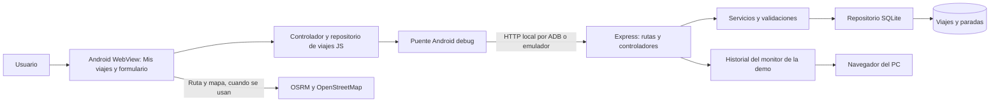
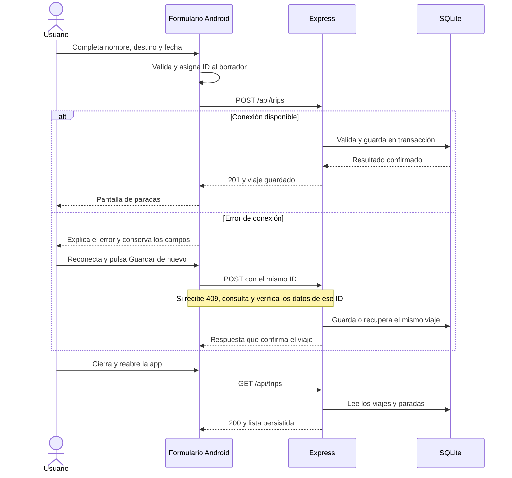
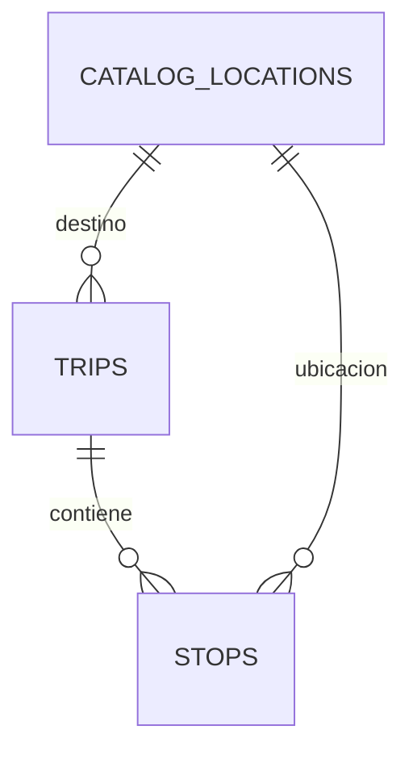

# Wooloo · Diagramas de arquitectura del Hito 3

## Componentes e integración

La API escucha en el PC en `127.0.0.1:43101` en modo demo. El puente usa `127.0.0.1` con ADB reverse en un teléfono y `10.0.2.2` en el emulador. El monitor observa tráfico de Viajes del modo demo. El cálculo vial y el mapa tienen sus propios proveedores.

## Ciclo de guardado, desconexión y reintento

## Datos

El viaje y sus paradas se escriben en una transacción. La clave foránea del viaje elimina sus paradas al borrar el viaje. Una ubicación referenciada se conserva y la API responde 409 si se intenta eliminar.
